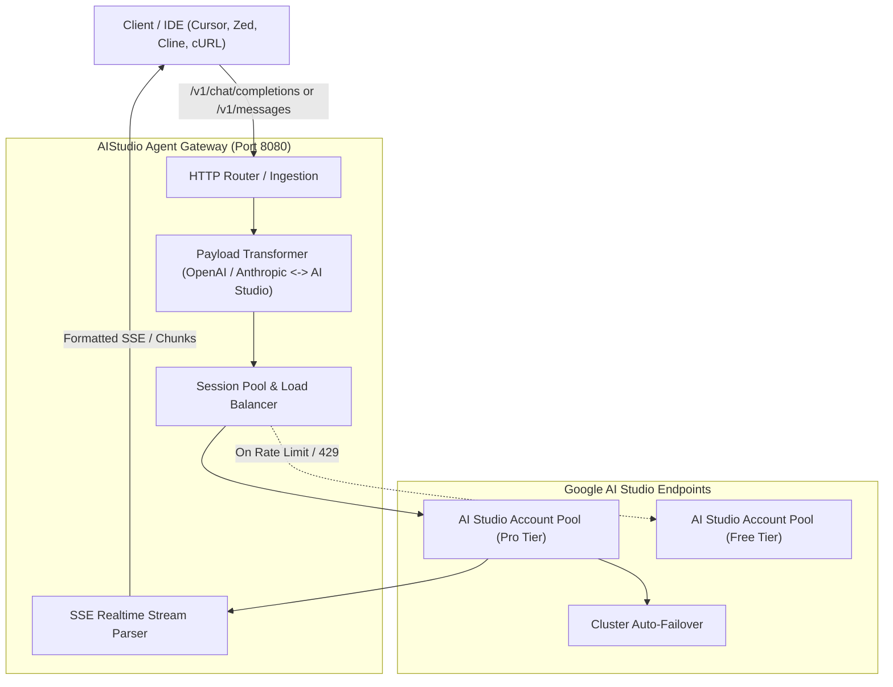

# ⚡ AIStudio Agent: Universal Google AI Studio Gateway & Payload Engine

[](https://www.python.org/)
[](https://opensource.org/licenses/MIT)
[](https://github.com/RealTrueHieu/aistudio-agent)
[](https://github.com/RealTrueHieu/aistudio-agent)
[](https://github.com/RealTrueHieu/aistudio-agent)

> **Autonomous Gateway & Payload Transformation Engine for Google AI Studio.**  
> Seamlessly bridges **OpenAI Chat Completions** (`/v1/chat/completions`) & **Anthropic Messages** (`/v1/messages`) protocols into Google AI Studio native format (`GenerateContent`).  
> **100% Pure Python Standard Library — Zero External Dependencies (`pip install 0`)!**

---

## 🌟 Key Highlights

* **Zero External Dependencies**: Works straight out of the box with any Python 3.8+ installation (`urllib`, `http.server`, `json`, `threading`).
* **Universal 2-Way Protocol Transformer**:
  - Translates OpenAI Chat & Anthropic Claude requests into Google AI Studio native JSON/Protobuf specifications.
  - Automatically handles `systemInstruction`, multi-turn `contents`, `generationConfig`, and `safetySettings`.
* **Deep Thinking & Reasoning Engine**:
  - Full native support for Gemini 2.5 / 3.8 / 4.0 reasoning budgets (`thinkingConfig.thinkingBudget`, `includeThoughts: true`).
  - Separates reasoning traces (`reasoning_content`) from actual response tokens in real-time SSE streaming.
* **Autonomous Multi-Account Session Pool**:
  - In-memory Round-Robin load balancer across multiple accounts.
  - Pro Tier prioritization, automatic rate-limit detection (`429 / 503`), and smart exponential cooldown recovery.
* **Drop-in IDE Compatibility**:
  - Works instantly with **Zed Editor**, **Cursor**, **Cline**, **Claude Code**, **Continue.dev**, **NextChat**, and **Cherry Studio**.

---

## 🏗️ Architecture Overview



---

## 📂 Repository Structure

```text
aistudio-agent/
├── aistudio_agent.py          # Core Engine: CLI Agent, Gateway Server & Python SDK
├── payload_transformer.py     # Bi-directional Protocol Transformer (OpenAI/Anthropic <-> AI Studio)
├── session_manager.py         # Multi-account pool, load balancer, health checks & cooldowns
├── test_agent.py              # Zero-dependency unit test suite
├── SKILL.md                   # Antigravity & Agentic Frameworks skill definition
├── LICENSE                    # MIT License
├── requirements.txt           # Optional dependencies (optional aiohttp/requests)
├── .gitignore                 # Standard clean Git ignore rules
├── README.md                  # Comprehensive Documentation
└── examples/
    ├── python_sdk_example.py  # Python OpenAI SDK drop-in integration
    ├── curl_examples.sh       # Ready-to-run terminal cURL commands
    └── raw_payload_samples.json # Sample native AI Studio JSON requests
```

---

## 🚀 Quick Start

### 1. Run as a Standalone Local Gateway Server

Start the lightweight gateway server on port `8080` (or custom port):

```bash
# Start Gateway on port 8080
python aistudio_agent.py --serve --port 8080

# Or run with custom upstream endpoint / API Key:
python aistudio_agent.py --serve --port 8080 --endpoint https://truehieu.eu.cc --api-key your-api-key
```

Your local gateway now exposes industry-standard endpoints:
* **OpenAI Chat Completions:** `http://127.0.0.1:8080/v1/chat/completions`
* **Anthropic Claude Messages:** `http://127.0.0.1:8080/v1/messages`
* **Models Catalog:** `http://127.0.0.1:8080/v1/models`
* **Health Check:** `http://127.0.0.1:8080/healthz`

---

### 2. Interactive CLI Agent (Direct Terminal Usage)

Ask questions directly from your terminal with streaming output:

```bash
# Quick query with default model
python aistudio_agent.py "Explain the Raft Consensus Algorithm in 3 bullet points"

# Specify a high-speed flash model
python aistudio_agent.py --model gemini-3.8-flash "How does TCP cubic work?"

# Query with Deep Reasoning (Thinking Budget: 2048 tokens)
python aistudio_agent.py --model gemini-2.5-pro --thinking 2048 "Solve this system of modular equations..."
```

---

### 3. Embed Directly into Python (SDK Mode)

You can use `AIStudioAgent` as an internal class in any Python script:

```python
from aistudio_agent import AIStudioAgent

agent = AIStudioAgent()

# 1. Non-streaming call
response = agent.chat("Explain Zero-Knowledge Proofs simply.", model="gemini-2.5-pro")
print(response["choices"][0]["message"]["content"])

# 2. Real-time Streaming (Tokens + Deep Reasoning)
for token in agent.stream("Write a quick Python generator for prime numbers.", model="gemini-3.8-flash"):
    print(token, end="", flush=True)
```

---

## 💻 IDE & Tool Integrations

### Zed Editor (`~/.config/zed/settings.json`)
```json
{
  "language_models": {
    "openai": {
      "api_url": "http://127.0.0.1:8080/v1",
      "available_models": [
        { "name": "ais/gemini-4-argon", "max_tokens": 8192 },
        { "name": "gemini-2.5-pro", "max_tokens": 8192 },
        { "name": "gemini-3.8-flash", "max_tokens": 8192 }
      ]
    }
  }
}
```

### Cursor / Continue.dev / Cline
* **Base URL:** `http://127.0.0.1:8080/v1`
* **API Key:** `any-string` (or your configured master key)
* **Model:** `gemini-2.5-pro` or `gemini-3.8-flash` or `gemini-4-argon`

---

## 🔄 Payload Transformation Cheat Sheet

| OpenAI / Anthropic Field | Google AI Studio Native Field | Processing Logic |
| :--- | :--- | :--- |
| `messages: [{"role": "system", ...}]` | `systemInstruction: {"parts": [{"text": ...}]}` | Extracted & formatted as dedicated instruction |
| `messages: [{"role": "user", ...}]` | `contents: [{"role": "user", "parts": [...]}]` | Mapped to user turn with structured parts |
| `messages: [{"role": "assistant", ...}]` | `contents: [{"role": "model", "parts": [...]}]` | Mapped to `model` role |
| `thinking: {"budget_tokens": 2048}` | `generationConfig: {"thinkingConfig": {...}}` | Enables internal reasoning token generation |
| `tools: [{"type": "function", ...}]` | `tools: [{"functionDeclarations": [...]}]` | Validated and translated to Protobuf schema |
| `image_url: {"url": "data:image/..."}` | `inlineData: {"mimeType": "...", "data": "..."}` | Automatically extracts MIME & pure Base64 |

---

## 🧪 Self-Test Suite

Run the built-in test suite to verify transformations and session pooling:

```bash
python test_agent.py
```

Expected output:
```text
=== AI STUDIO AGENT TEST SUITE ===
[1/3] Testing OpenAI -> AI Studio Transformation...
      PASSED!
[2/3] Testing Anthropic -> AI Studio Transformation...
      PASSED!
[3/3] Testing Session Pool & Load Balancer...
      PASSED!

ALL UNIT TESTS PASSED SUCCESSFULLY! Ready for open source.
```

---

## 👥 Tóm Tắt Tiếng Việt (Vietnamese Summary)

* **Gói Agent độc lập 100% Python Standard Library**: Không cần bất kỳ lệnh `pip install` nào.
* **Tự động dịch Payload**: Chuyển đổi thông suốt các định dạng từ OpenAI & Anthropic Claude sang chuẩn native của Google AI Studio (`GenerateContent`).
* **Hỗ trợ đầy đủ**: Streaming SSE, tư duy sâu (Reasoning / Thinking tokens), Tool / Function Calling và phân giải hình ảnh Multimodal Base64.
* **Tích hợp tức thì**: Chạy lệnh `python aistudio_agent.py --serve` là có ngay local Gateway Server kết nối với Zed Editor, Cursor, Cline, Claude Code.

---

## 📄 License

This project is licensed under the [MIT License](LICENSE) - see the LICENSE file for details.  
Created with ❤️ by **[RealTrueHieu](https://github.com/RealTrueHieu)** & **Antigravity**.
