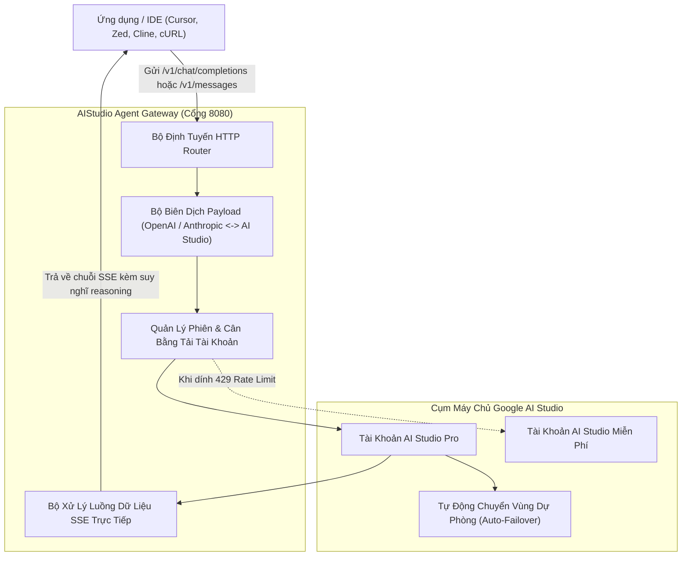

# ⚡ AIStudio Agent: Cổng Kết Nối & Bộ Chuyển Đổi Payload Google AI Studio Độc Lập

[](https://www.python.org/)
[](https://opensource.org/licenses/MIT)
[-brightgreen.svg)](https://github.com/RealTrueHieu/aistudio-agent)
[](https://github.com/RealTrueHieu/aistudio-agent)
[](https://github.com/RealTrueHieu/aistudio-agent)

> **Cổng Gateway & Bộ biên dịch Payload Google AI Studio thuần Python.**  
> Chuyển đổi thông suốt chuẩn giao thức **OpenAI Chat Completions** (`/v1/chat/completions`) & **Anthropic Claude Messages** (`/v1/messages`) sang đúng định dạng native của Google AI Studio (`GenerateContent`).  
> **100% Python Standard Library — Không cần cài đặt bất kỳ thư viện ngoài nào (`pip install 0`)!**

---

## 🌟 Điểm Nổi Bật Của Dự Án

* **Không Phụ Thuộc Thư Viện Ngoài (Zero External Dependencies)**:
  - Chạy ngay lập tức trên mọi máy tính đã cài Python 3.8+ mà không cần `pip install` bất cứ gói nào (hoàn toàn dùng thư viện chuẩn `urllib`, `http.server`, `json`, `threading`).
* **Biên Dịch Payload Hai Chiều Hoàn Hảo**:
  - Tự động nhận diện và bóc tách `systemInstruction`, nội dung hội thoại nhiều lượt (`contents`), cấu hình sinh câu trả lời (`generationConfig`) và bộ lọc an toàn (`safetySettings`).
* **Hỗ Trợ Luồng Suy Nghĩ Sâu (Deep Thinking / Reasoning Budget)**:
  - Tương thích đầy đủ tham số `thinkingConfig` (`thinkingBudget`, `includeThoughts: true`) trên các dòng mô hình mới (Gemini 2.5, Gemini 3.8, Gemini 4.0 Argon).
  - Tách bạch luồng suy nghĩ (`reasoning_content`) và nội dung trả lời (`content`) theo thời gian thực (Real-time SSE Streaming).
* **Quản Lý Phiên & Cân Bằng Tải Đa Tài Khoản (Session Pool)**:
  - Tích hợp sẵn bộ điều phối Round-Robin luân phiên nhiều tài khoản AI Studio.
  - Tự động nhận diện tài khoản Pro Tier, tự phát hiện rate limit (`HTTP 429` / `503`) để đưa tài khoản vào thời gian chờ (cooldown) và tự phục hồi khi hết hạn.
* **Tương Thích Mọi Trình Soạn Thảo & Ứng Dụng AI**:
  - Dùng làm Local Gateway cắm trực tiếp vào **Zed Editor**, **Cursor**, **Cline**, **Claude Code**, **Continue.dev**, **NextChat**, **Cherry Studio**.

---

## 🏗️ Sơ Đồ Kiến Trúc Hệ Thống



---

## 📂 Cấu Trúc Mã Nguồn

```text
aistudio-agent/
├── aistudio_agent.py          # Script trung tâm: CLI Agent, Gateway Server & Python SDK
├── payload_transformer.py     # Bộ biên dịch Payload 2 chiều: OpenAI/Anthropic <-> AI Studio
├── session_manager.py         # Quản lý tài khoản, cân bằng tải Round-Robin & tự động cooldown
├── test_agent.py              # Bộ kiểm thử tự động (Unit Test 100% offline)
├── SKILL.md                   # File đặc tả kỹ năng cho Antigravity & Agentic Frameworks
├── LICENSE                    # Giấy phép mã nguồn mở MIT
├── requirements.txt           # File requirements (tùy chọn)
├── .gitignore                 # Bỏ qua các file rác, virtualenv, pycache
├── README.md                  # Tài liệu hướng dẫn sử dụng tiếng Việt
└── examples/
    ├── python_sdk_example.py  # Mẫu code Python gọi qua SDK chuẩn OpenAI
    ├── curl_examples.sh       # Các lệnh cURL mẫu chạy trực tiếp từ Terminal
    └── raw_payload_samples.json # File JSON mẫu payload native của Google AI Studio
```

---

## 🚀 Hướng Dẫn Sử Dụng Nhanh

### Cách 1: Khởi Chạy Local Gateway Server (Khuyên Dùng Cho IDE)

Chạy lệnh sau trên terminal để mở một máy chủ Gateway trung gian tại máy tính của bạn:

```bash
# Khởi động server trên cổng mặc định 8080
python aistudio_agent.py --serve --port 8080

# Hoặc tùy biến endpoint upstream và API Key của bạn:
python aistudio_agent.py --serve --port 8080 --endpoint https://your-gateway.com --api-key your-api-key
```

Sau khi chạy, server sẽ cung cấp các đường dẫn API chuẩn quốc tế:
* **Endpoint OpenAI Chat:** `http://127.0.0.1:8080/v1/chat/completions`
* **Endpoint Anthropic Messages:** `http://127.0.0.1:8080/v1/messages`
* **Danh mục Models:** `http://127.0.0.1:8080/v1/models`
* **Kiểm tra trạng thái:** `http://127.0.0.1:8080/healthz`

---

### Cách 2: Sử Dụng Như CLI Agent (Hỏi Đáp Trực Tiếp Từ Dòng Lệnh)

Bạn có thể trò chuyện hoặc hỏi code ngay trên cửa sổ Command Prompt / PowerShell / Terminal:

```bash
# Hỏi nhanh với model mặc định (tự động stream kết quả ra màn hình)
python aistudio_agent.py "Giải thích thuật toán đồng thuận Raft trong 3 gạch đầu dòng"

# Chỉ định mô hình Flash tốc độ cao
python aistudio_agent.py --model gemini-3.8-flash "Cơ chế bắt tay 3 bước của TCP hoạt động thế nào?"

# Hỏi kèm budget suy nghĩ chuyên sâu (Thinking Budget: 2048 tokens)
python aistudio_agent.py --model gemini-2.5-pro --thinking 2048 "Giải bài toán tìm dãy con tăng dài nhất bằng Quy Hoạch Động trong Python"
```

---

### Cách 3: Nhúng Trực Tiếp Vào Source Code Python (SDK Mode)

Không cần mở server, bạn có thể `import` trực tiếp class `AIStudioAgent` vào bất kỳ file Python nào trong dự án của bạn:

```python
from aistudio_agent import AIStudioAgent

# Khởi tạo agent
agent = AIStudioAgent()

# 1. Gọi dạng Non-streaming (nhận toàn bộ kết quả một lần)
ket_qua = agent.chat("Giải thích công nghệ Zero-Knowledge Proof thật đơn giản.", model="gemini-2.5-pro")
print(ket_qua["choices"][0]["message"]["content"])

# 2. Gọi dạng Streaming trực tiếp (nhận từng token kèm suy nghĩ reasoning)
print("\nĐang sinh câu trả lời:")
for token in agent.stream("Viết hàm Python kiểm tra số nguyên tố tối ưu nhất.", model="gemini-3.8-flash"):
    print(token, end="", flush=True)
```

---

## 💻 Hướng Dẫn Tích Hợp Vào Các Trình Soạn Thảo (IDE)

### 1. Cấu hình trên Zed Editor (`~/.config/zed/settings.json`)
```json
{
  "language_models": {
    "openai": {
      "api_url": "http://127.0.0.1:8080/v1",
      "available_models": [
        { "name": "gemini-4-argon", "max_tokens": 8192 },
        { "name": "gemini-2.5-pro", "max_tokens": 8192 },
        { "name": "gemini-3.8-flash", "max_tokens": 8192 }
      ]
    }
  }
}
```

### 2. Cấu hình trên Cursor / Cline / Continue.dev
* **API Provider:** Chọn `OpenAI Compatible`
* **Base URL:** `http://127.0.0.1:8080/v1`
* **API Key:** Điền bất kỳ ký tự nào (ví dụ: `sk-aistudio-local`)
* **Model Name:** Điền `gemini-2.5-pro`, `gemini-3.8-flash` hoặc `gemini-4-argon`

---

## 🔄 Bảng Quy Đổi Chi Tiết Payload (Payload Cheat Sheet)

Dưới đây là chi tiết cách bộ `payload_transformer.py` xử lý tương thích giữa các chuẩn:

| Trường OpenAI / Anthropic | Trường Chuẩn Native Google AI Studio | Giải Thích Chi Tiết Cách Xử Lý |
| :--- | :--- | :--- |
| `messages: [{"role": "system", ...}]` | `systemInstruction: {"parts": [{"text": ...}]}` | Bóc tách system prompt thành chỉ thị hệ thống độc lập |
| `messages: [{"role": "user", ...}]` | `contents: [{"role": "user", "parts": [...]}]` | Chuyển đổi lượt hội thoại user thành mảng parts chuẩn |
| `messages: [{"role": "assistant", ...}]` | `contents: [{"role": "model", "parts": [...]}]` | Google bắt buộc dùng role `model` thay vì `assistant` |
| `thinking: {"budget_tokens": 2048}` | `generationConfig: {"thinkingConfig": {...}}` | Kích hoạt bộ sinh token tư duy sâu nội bộ |
| `tools: [{"type": "function", ...}]` | `tools: [{"functionDeclarations": [...]}]` | Chuyển đổi định dạng Schema JSON sang Protobuf declaration |
| `image_url: {"url": "data:image/..."}` | `inlineData: {"mimeType": "...", "data": "..."}` | Tự động bóc tách MIME type và chuỗi Base64 sạch |

---

## 🧪 Chạy Kiểm Thử Hệ Thống (Self-Test)

Để đảm bảo mọi chức năng biến đổi và điều phối phiên hoạt động chính xác 100%, bạn chỉ cần chạy file test:

```bash
python test_agent.py
```

Kết quả chuẩn đạt được:
```text
=== AI STUDIO AGENT TEST SUITE ===
[1/3] Testing OpenAI -> AI Studio Transformation...
      PASSED!
[2/3] Testing Anthropic -> AI Studio Transformation...
      PASSED!
[3/3] Testing Session Pool & Load Balancer...
      PASSED!

ALL UNIT TESTS PASSED SUCCESSFULLY! Ready for open source.
```

---

## 📄 Giấy Phép & Tác Quyền

Dự án này được phân phối dưới giấy phép mã nguồn mở **[MIT License](LICENSE)** - hoàn toàn tự do sử dụng trong các dự án cá nhân và thương mại.  
Được phát triển với tất cả tâm huyết bởi **[RealTrueHieu](https://github.com/RealTrueHieu)** & **Antigravity**.
